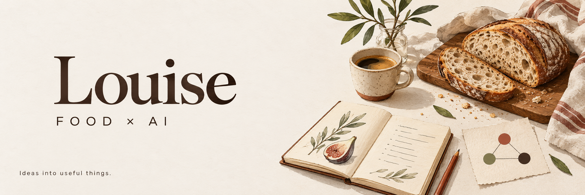

### 你好，我是 Louise。

食品研发出身，喜欢琢磨好吃的产品，也喜欢把工作里反复遇到的问题，做成用得上的工具。

在这里，记录我把 **食品、设计和 AI** 放在一起的尝试。

#### 食品与产品 · Selected work

| [食品产品卡](https://github.com/louiseboo/food-product-cards) | [食品工作台](https://github.com/louiseboo/site) |
| :--- | :--- |
| 产品卡、菜单模板与配料拆解图，让产品信息更直观。 | 从食品资料整理到研发工作流，保留早期 CategoryLab 的探索。 |

#### AI 与日常 · Learning by doing

关注 AI 怎样接住真实工作：整理信息、串联流程，也给人的判断留出空间。

[Raven](https://github.com/louiseboo/Raven) · [EverOS](https://github.com/louiseboo/EverOS) 是我用于学习与本地实践的个人分叉，原项目来自 [EverMind AI](https://github.com/EverMind-AI)。
